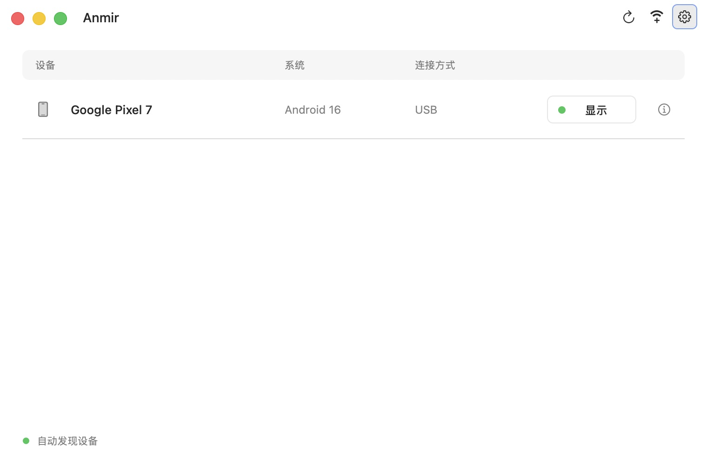
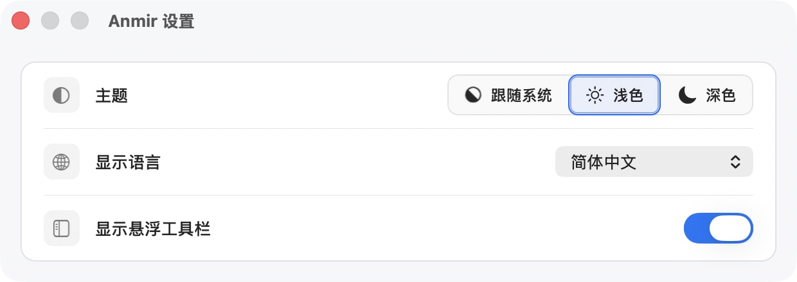

# Anmir

[简体中文](README.md) · [English](README.en.md)

将安卓设备的屏幕投到 Mac，并用键盘和鼠标控制设备。基于 [scrcpy](https://github.com/Genymobile/scrcpy)，提供原生 macOS 界面、设备管理和无线配对。内置 adb，无需另装 Homebrew 或 Android SDK。

> /ˈæn.mɪr/（安米尔）· An(droid) + mir(ror)

## 特色功能

- **USB 与无线连接**：自动发现安卓设备，支持二维码、配对码和手动输入地址连接；同一设备的 USB 与无线连接合并展示。
- **多设备投屏**：每台设备拥有独立投屏窗口和 Dock 入口，可随时打开设备列表。
- **截图与录屏**：设备截图复制到 Mac 剪贴板；录制设备屏幕时显示时长，并可选择文件保存位置。
- **原生 macOS 体验**：悬浮工具栏提供返回、主页、最近任务、截图和录屏操作；应用外观支持浅色、深色与跟随系统。
- **多语言切换**：应用界面支持简体中文、繁体中文和英文，切换后即时生效；设置自动保存并同步到投屏窗口。
- **本地直连**：投屏无需账号或云端转发；ADB 连接也可用于调试与日志采集。

## 下载

[最新版本](https://github.com/laobie/Anmir/releases/latest) · macOS 11+ · Apple Silicon / Intel

设备系统要求：USB 投屏需 Android 5.0+，无线配对需 Android 11+。

## 界面预览



<details>
<summary>查看无线连接与设置</summary>




</details>

## 快速开始

1. 打开 DMG，将 Anmir 拖入“应用程序”并打开。
2. 在安卓设备上开启“开发者选项 → USB 调试”。
3. 用 USB 数据线连接设备和 Mac，并在设备上允许 USB 调试。一台可用设备时自动投屏，多台时从列表选择。

**无线连接**：设备与 Mac 连到同一网络，在设备上开启“开发者选项 → 无线调试”。点击 Anmir 的 Wi-Fi 加号，用设备的“使用二维码配对设备”入口扫码，也可切换到配对码连接；已配对设备可手动输入 IP 地址和连接端口。

**日常操作**：使用投屏窗口旁的工具栏控制设备、截图或录屏。点击设备列表或投屏窗口右上角的齿轮可打开 Anmir 设置，也可按 `⌘,`。

首次打开 Anmir 若被 macOS 拦截，双击 DMG 窗口或 ZIP 解压目录中的 **Privacy & Security** 快捷入口，在“隐私与安全性”中选择 Anmir 对应的“仍要打开”。安装包尚未经过 Apple 公证，详见 [Apple 说明](https://support.apple.com/102445)。

## 命令行

应用内的 `anmir` 命令兼容 scrcpy 参数：

```sh
/Applications/Anmir.app/Contents/MacOS/anmir --help
/Applications/Anmir.app/Contents/MacOS/anmir --serial DEVICE_SERIAL
```

## 文档与反馈

[构建与 LGPL 重新链接](doc/build-anmir.md) · [快捷键](doc/shortcuts.md) · [连接](doc/connection.md) · [音频](doc/audio.md) · [macOS 架构](doc/macos-architecture.md)

反馈请到 [Issues](https://github.com/laobie/Anmir/issues)，附上 Anmir 版本、Mac 芯片、macOS 与 Android 版本及连接方式。

## 更新记录

| 版本 | 日期 | 更新内容 | 发布页 |
| --- | --- | --- | --- |
| v0.1.0 | 2026-10-25 | 首次发布：原生设备管理、USB/无线投屏、截图录屏与多语言。 | [Release](https://github.com/laobie/Anmir/releases/tag/v0.1.0) |

## 开源许可

基于上游 scrcpy v4.1 独立维护，非 Genymobile 官方项目。

采用 [Apache 2.0](LICENSE)，保留[上游署名](NOTICE)；依赖许可证见 [THIRD_PARTY.md](THIRD_PARTY.md)。

Android is a trademark of Google LLC.
